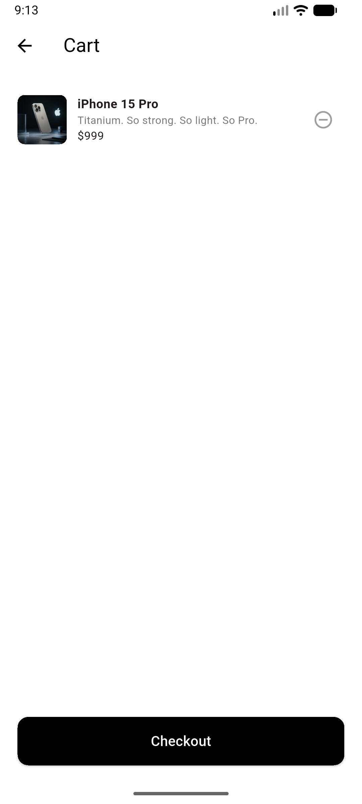

# Mini Catalog Flutter

Flutter ile yapilmis basit mini katalog uygulamasi. Mobil uygulama gelistirme egitiminin final projesi.

Urunler wantapi.com dan cekilir grid ile listelenir urun detayi gosterilir ve basit bir sepet vardir.

## Ekran Goruntuleri

| Ana Sayfa | Urun Detayi | Sepet |
|:---:|:---:|:---:|
|  |  |  |

## Ozellikler

- Ana sayfa arama banner ve GridView ile urun kartlari
- Urun detay sayfasi ve sepete ekleme
- Sepet sayfasi urun silme ve bos sepet ekrani
- Navigator push ve named route ile route arguments
- Internet yoksa assets/data/products.json kullanilir

## Flutter Surumu

- Flutter 3.50.0
- Dart 3.14.0

## Klasor Yapisi

```
lib/
  main.dart
  models/products_model.dart
  services/api_service.dart
  views/home_screen.dart
  views/product_detail_screen.dart
  views/cart_screen.dart
  components/product_card.dart
  components/mini_card_tile.dart
assets/data/products.json
```

## Calistirma

```bash
git clone https://github.com/asuzey/Mini-Catalog-Flutter.git
cd Mini-Catalog-Flutter
flutter pub get
flutter run
```

## Not

Urun verileri egitim ve demo amaclidir.

 -  Bu readme sayfasının düzenlenmesinde ai desteği alinmistir.

## Teşekkür

Bu projeyi nasıl yapabileceğimizi öğreten ve bu eğitimi bize sağlayan TNC Group Software Persona'ya teşekkür ederim.
- Asuman Zeynep Bayram
